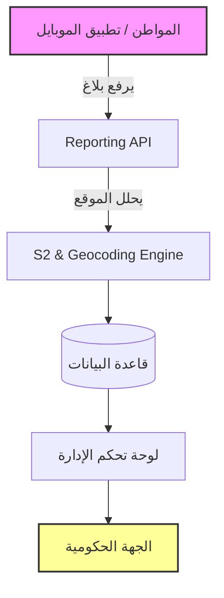
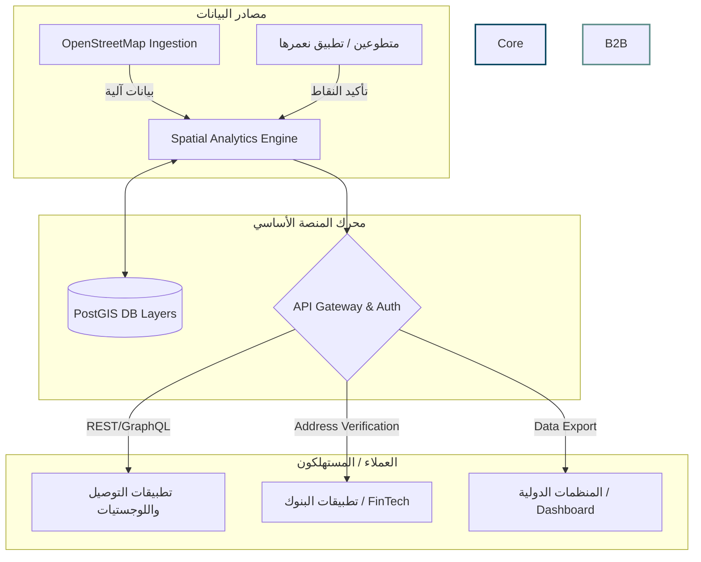

# المخطط الشامل للتحول (Pivot Master Plan)
**من "تطبيق بلاغات مدنية" إلى "منصة استخبارات مكانية وعنونة ذكية" (Geospatial Data Platform)**

---

## الجزء الأول: نموذج العمل التجاري المتكامل (Business Model Canvas)

| العنصر | الوصف (النموذج الجديد للـ B2B / B2G) |
| :--- | :--- |
| **1. شرائح العملاء (Customer Segments)** | - **شركات التوصيل واللوجستيات:** (طلبات، مرسول، البريد). - **شركات التقنية المالية (FinTech):** البنوك والمحافظ الإلكترونية (لإثبات السكن). - **شركات السلع الاستهلاكية (FMCG):** (بيبسي، دال، الخ) لتوزيع المنتجات. - **المنظمات الدولية (NGOs):** لتحليل جودة البنية التحتية والمخاطر. |
| **2. عرض القيمة (Value Proposition)** | - **للشركات:** "تقليل تكلفة التوصيل الضائع بنسبة 30% من خلال عنونة دقيقة 100%". - **للبنوك:** "وثّق عنوان سكن عميلك رقمياً وبدون أوراق رسمية". - **للمنظمات:** "بيانات جغرافية حية ودقيقة لتوزيع المساعدات والتدخل السريع". |
| **3. مصادر الإيرادات (Revenue Streams)** | - **Pay-Per-API Call:** رسوم بالقرش/السنت على كل عملية توليد أو قراءة للعنوان. - **SaaS Subscription:** اشتراك شهري للشركات للوصول للوحات التحليل (Heatmaps). - **Data Licensing:** بيع حقائب بيانات مُجمّعة للمنظمات (تاريخية أو سنوية). |
| **4. القنوات (Channels)** | - **Direct B2B Sales:** اجتماعات مباشرة مع المدراء التقنيين (CTOs). - **Developer Portal:** موقع مخصص للمبرمجين به توثيق API ليجربوا الخدمة. - **API Marketplaces:** عرض الـ API في منصات عالمية (RapidAPI). |
| **5. العلاقات مع العملاء (Customer Relationships)** | - **Self-Service:** للمطورين والشركات الناشئة (اشتراك ودفع آلي). - **Dedicated Account Manager:** لعملاء الـ Enterprise (البنوك والشركات الكبرى). |
| **6. الأنشطة الرئيسية (Key Activities)** | - تطوير وصيانة خوارزميات الـ (S2 Geometry & Plus Codes). - إدارة وتحديث طبقات البيانات (Data Ingestion & Moderation). - المبيعات والشراكات (B2B Sales). |
| **7. الموارد الرئيسية (Key Resources)** | - **المورد التقني:** الخوارزمية الجغرافية وقاعدة البيانات المكانية (PostGIS). - **المورد البشري:** المتطوعون (لإثبات البيانات) ومهندسو البيانات. - **البنية التحتية:** سيرفرات سحابية قادرة على معالجة ملايين الطلبات. |
| **8. الشراكات الرئيسية (Key Partnerships)** | - **مزودي البيانات المفتوحة:** OpenStreetMap. - **شركات الاتصالات:** (رعاية أو توفير حزم إنترنت للمتطوعين). - **مبادرات مجتمعية:** مجموعات شبابية لتوثيق البيانات مقابل مكافآت. |
| **9. هيكل التكاليف (Cost Structure)** | - تكاليف الاستضافة والخوادم (Cloud Computing). - تكاليف التسويق والمبيعات المباشرة للـ B2B. - تكافؤ المتطوعين (Gamification Rewards). |

---

## الجزء الرابع: تكامل المدفوعات المحلية (Sudanese Payment Integration)
لضمان سهولة التحصيل المالي في السوق السوداني، سيعتمد نظام الفوترة على:
- **تكامل MyCashy / Cashi:** للدفع الآلي الفوري عبر نقاط البيع والمحافظ.
- **دعم بنكك (Bankak):** عبر نظام تأكيد رقم المعاملة (Manual/Semi-auto Verification).
- **محفظة برافو (Bravo):** كخيار إضافي للدفع الرقمي السريع.
- **التسعير المرن:** دعم الفوترة بالجنيه السوداني (SDG) مع ربطها بسعر الصرف.

---

## الجزء الثاني: المخططات المعمارية للتحول (Technical Architecture Transformation)

### 1. المعمارية السابقة (تطبيق بلاغات B2G)
كان النظام يعتمد على استقبال البلاغات وتوجيهها للوحة تحكم للإدارة.

### 2. المعمارية الجديدة (منصة بيانات جغرافية و API لشركات B2B)
يصبح محرك (S2 Engine) هو قلب النظام، ويصبح تطبيق الموبايل مجرد أداة لإضافة أو تأكيد البيانات، بينما الإيراد الحقيقي يأتي من الشركات المستهلكة للـ API.

---

## الجزء الثالث: خارطة طريق التحول التقني (Technical Implementation Roadmap)

للوصول إلى هذه المعمارية، نحتاج إلى الانتقال البرمجي في الـ Backend عبر 4 مراحل رئيسية:

### المرحلة 1: إعادة هيكلة قاعدة البيانات (Database Restructuring)
التحول من جداول البلاغات فقط إلى جداول الطبقات (Layers).
- **الكيانات الجديدة (Entities):**
  - `MapLayer`: (الاسم، الوصف، الصلاحيات - عام/خاص).
  - `GeoFeature`: (إحداثيات S2، خصائص JSON مرنة، الحالة: مؤكد/قيد الانتظار).
  - `ClientApiKeys`: (لإدارة وصول الشركات (B2B) واحتساب التكلفة Billing).

### المرحلة 2: محرك استيراد البيانات (Data Ingestion Engine)
- بناء `Laravel Console Command` لجلب البيانات المفتوحة.
- **التنفيذ:** استخدام `Overpass API` لسحب المخابز، الصيدليات، والمستشفيات، وتحويلها لـ S2 Cells وحفظها في `GeoFeature` لتلقيح قاعدة البيانات وتجنب البداية الباردة (Cold Start).

### المرحلة 3: بناء بوابة הـ B2B API (API Gateway & Rate Limiting)
- فصل الـ API الخاص بتطبيق المواطنين عن الـ API التجاري للشركات.
- استخدام `Laravel Sanctum` أو `Passport` لإصدار `API Keys` للشركات.
- بناء Endpoints تجارية مثل:
  - `GET /v2/address/verify` (للـ FinTech).
  - `GET /v2/spatial/route-quality` (لشركات التوصيل).

### المرحلة 4: تحديث تطبيق "نعمرها صاح" للمواطنين (Gamified UGC)
- تحويل واجهة التطبيق لتعرض خريطة "المهمات".
- مثال: يظهر للمستخدم نقطة لمخبز ويطلب منه تأكيد عمله بالتقاط صورة مقابل رصيد/نقاط.
- تحويل البلاغات القديمة (تسريب مياه، حفرة) لتكون مجرد بيانات تضاف في `Layer` يسمى (جودة البنية التحتية) وتباع كبيانات لشركات التأمين بدلاً من انتظار تفاعل البلدية.
