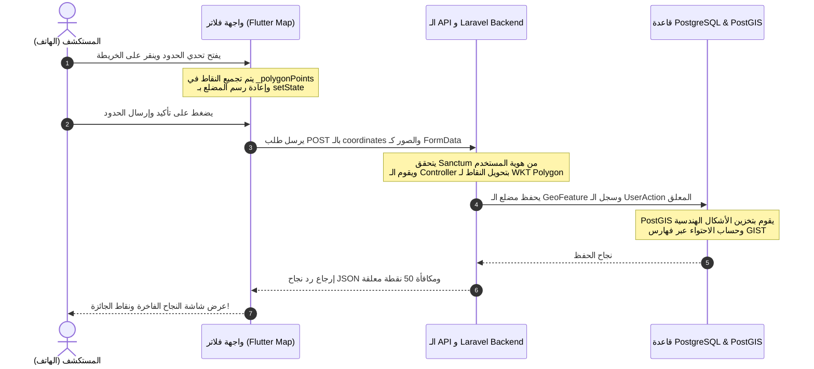

# 💙 الدرس الثالث (الموسع): دمج الخرائط وخدمات المواقع والربط الشبكي المتكامل بالـ APIs في Flutter

في هذا الدرس الختامي والمثير، سنقوم بربط شاشة الهاتف بخدمات تحديد المواقع العالمية الـ GPS، الخرائط التفاعلية (Flutter Map)، وحزم الشبكات المتقدمة (Dio) لإتمام دورة البيانات بالكامل وإرسال المساهمات الجغرافية والصور الملتقطة بكاميرا الهاتف للـ Backend ليتم تخزينها وحفظها!

---

## 1. التقاط إحداثيات الـ GPS والتحقق من الصلاحيات (Permissions)
قبل التمكن من قراءة موقع الهاتف بدقة، يجب أولاً التحقق من موافقة المستخدم وصلاحيات نظام التشغيل (Android / iOS).

### 💡 تطبيق عملي موسع من مشروعك:
افتح ملف [add_place_screen.dart](file:///c:/namerha_sah/frontend/lib/features/add_place/screens/add_place_screen.dart) (السطر 107 تقريباً) وشاهد كيف تتم قراءة وحفظ الإحداثيات:
```dart
Future<void> _getCurrentLocation() async {
  bool serviceEnabled;
  LocationPermission permission;

  // 1. التحقق من تشغيل المستخدم لخدمة الـ GPS في الهاتف
  serviceEnabled = await Geolocator.isLocationServiceEnabled();
  if (!serviceEnabled) return;

  // 2. التحقق من صلاحيات التطبيق للوصول للموقع
  permission = await Geolocator.checkPermission();
  if (permission == LocationPermission.denied) {
    permission = await Geolocator.requestPermission();
    if (permission == LocationPermission.denied) return;
  }
  
  // 3. التقاط الموقع بدقة عالية وحفظه
  final pos = await Geolocator.getCurrentPosition(
    desiredAccuracy: LocationAccuracy.high
  );
  
  setState(() {
    _selectedPosition = LatLng(pos.latitude, pos.longitude);
  });
}
```

---

## 2. الخرائط التفاعلية ورسم المضلعات (Flutter Map & Polygons)
يعتمد تطبيقك على حزمة **Flutter Map** (وهي محرك خرائط Leaflet الشهير مفتوح المصدر) لعرض الخريطة كطبقات تفاعلية ورسم الأشكال فوقها بسلاسة تامة.

### 💡 طبقات الخريطة في مشروعك:
1. **طبقة الصور الأرضية (Tile Layer):** تُجلب من خوادم OpenStreetMap لعرض الشوارع والمعالم:
   ```dart
   TileLayer(
     urlTemplate: 'https://tile.openstreetmap.org/{z}/{x}/{y}.png',
   )
   ```
2. **طبقة مضلعات الحدود (Polygon Layer):** ترسم خطوطاً ملونة مغلقة تربط بين نقاط المضلع التي حددها المستخدم لعرض حدود القرية أو الحي:
   ```dart
   PolygonLayer(
     polygons: [
       Polygon(
         points: _polygonPoints,
         color: AppColors.brandBlue.withOpacity(0.2), // تعبئة شفافة للداخل
         borderColor: AppColors.brandBlue,          // خط الحدود كحلي داكن
         borderStrokeWidth: 3.0,                     // سماكة الخط
         isFilled: true,
       ),
     ],
   )
   ```

---

## 3. الربط الشبكي المتقدم ورفع الملفات باستخدام Dio
للاتصال بالـ Backend، يستخدم تطبيقك حزمة **Dio** المتميزة؛ وهي حزمة شبكات خارقة تتيح لنا إرسال طلبات سريعة، وإرفاق ترويسات مشفرة، ورفع الصور والملفات بكفاءة عالية.

### 💡 رفع استمارة معلم يحتوي على صورة ملتقطة بالكاميرا:
عندما يقوم مستخدم بإضافة مكان (صيدلية مثلاً) مع صورة للتوثيق، لا يمكننا إرسال الطلب كـ JSON عادي لأن البيانات تحتوي على ملف ثنائي (Binary Image File). 
لذلك نستخدم صيغة **Multipart Form Data**:

* **تطبيق الكود في تطبيقك:**
  ```dart
  Future<void> submitPlace({
    required String name,
    required double lat,
    required double lng,
    required String? imagePath,
  }) async {
    // 1. بناء مصفوفة البيانات العادية والملفات الجاهزة للرفع
    final formData = FormData.fromMap({
      'name': name,
      'latitude': lat,
      'longitude': lng,
      if (imagePath != null) ...{
        'image': await MultipartFile.fromFile(
          imagePath,
          filename: 'place_verification.jpg'
        ),
      }
    });

    // 2. إرسال الطلب للسيرفر والتحميل في الخلفية
    await api.dio.post(
      '/mobile/places',
      data: formData,
      onSendProgress: (sent, total) {
        // حساب وعرض نسبة رفع الصورة للمستكشف في أجزاء من الثانية!
        double progress = sent / total;
      }
    );
  }
  ```

---

## 🔄 مسار تدفق البيانات المتكامل 360 درجة (End-To-End Lifecycle)

لنفهم كيف يتكامل كل هذا النظام برمتـه، دعنا نتتبع دورة حياة عملية **"تحدي رسم حدود قرية"** من البداية وحتى النهاية:



هذا الترابط والتناغم التام بين أحدث التقنيات الجغرافية والبرمجية هو ما يجعل مشروعك **"نعمّرها صح"** تحفة برمجية وهندسية متكاملة! 🏆🇸🇩
